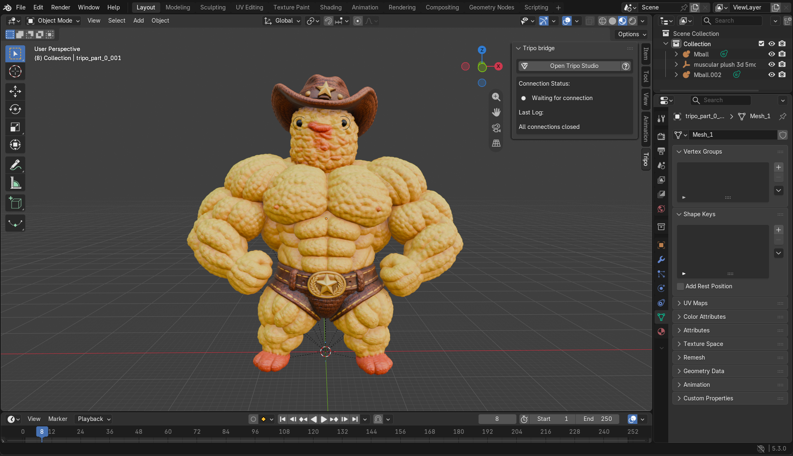
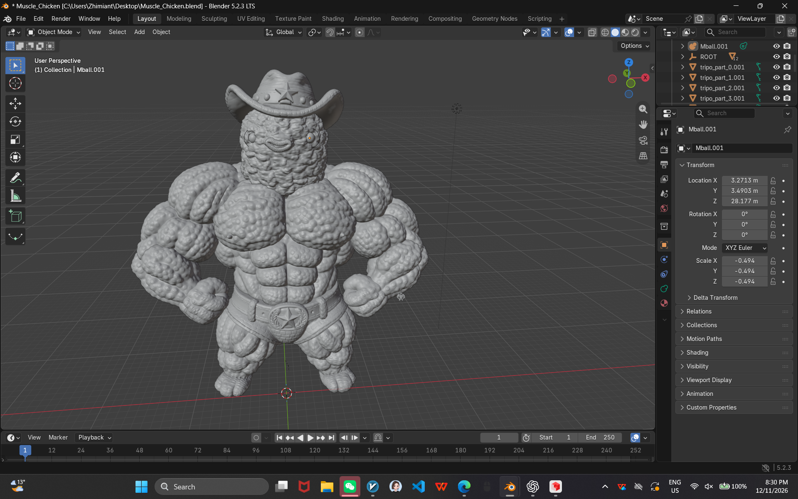

# MUSCLE CHICKEN
### From Physical Scanning to AI-Assisted 3D Character Design

**Class 01 — 3D Scanning & AI-Assisted 3D Modelling**  
**Wanwu Lab · November 2026**

> **Project overview** — Muscle Chicken explores the transformation of a real, crocheted chick into a playful digital character with a cowboy hat and exaggerated muscles. The project combines 3D scanning, AI image generation, Tripo-based 3D modelling, and Blender editing. This repository documents the workflow and provides the images and model files used throughout the process.

---

## 1. What Is It?

**Muscle Chicken** is a character-design experiment that connects physical objects with digital fabrication tools.

The starting point was a small yellow crocheted chick with a rounded silhouette and a distinctive textured surface. We captured its form using a 3D scanner, then used the chick as visual inspiration for a new character. The design preserves the recognizable round head and friendly face while introducing a cowboy hat, oversized arms, a muscular torso, and short legs.

The contrast between the chick's soft, cute appearance and its exaggerated strength gives the character its humorous identity. Rather than stopping at a generated image, we developed a three-dimensional model that can be viewed and further edited in Blender.

**Design process:** Physical object → 3D scan → AI concept image → AI-generated 3D model → Blender editing.

---

## 2. What Does It Do?

Muscle Chicken is a **static digital character**, not a mechanical or interactive product. Its purpose is to explore how a real object's identity can be reimagined through digital tools.

The project demonstrates three possibilities:

- **Character redesign:** Transforming a familiar, friendly object into a distinctive character through changes in proportion, costume, and body shape.
- **Digital presentation:** Examining the character from different angles in Blender to assess its silhouette, muscular forms, and relationships between parts.
- **Fabrication potential:** Using the 3D model as a starting point for mesh repair, scaling, slicing, and future 3D printing.

The repository includes a file named `final_print_ready.zip` as the final exported model package. **Physical printing and printability have not yet been documented or verified here.** Before printing, the model should be checked for correct dimensions, closed geometry, fragile details, and required supports.

---

## 3. How Was It Made?

### 3.1 Tools and Software

| Stage | Tool | Purpose |
| --- | --- | --- |
| 3D scanning | Revopoint POP 2 and Revo Scan | Capture the physical chick and export its scanned geometry |
| Concept development | ChatGPT image generation | Explore the cowboy hat, muscular body, and character proportions |
| AI 3D modelling | Tripo | Convert the character reference into a 3D model and inspect its components |
| Mesh editing | Blender | Import, position, scale, and refine the digital assets |
| Documentation | GitHub | Organize source files, progress images, and project records |

### 3.2 Step 01 — Scanning the Physical Chick

We used a **Revopoint POP 2** scanner and **Revo Scan** to capture the shape of the crocheted chick. The goal was to preserve the overall silhouette and the irregular texture of the yarn while checking the scan for missing or noisy areas.

Because the crocheted surface contains many small bumps and recesses, the resulting mesh is less uniform than a typical manufactured object. The original scan was therefore preserved separately from later editing files.

**Download:** [Original 3D scan](models/original_scan.zip)

### 3.3 Step 02 — Developing the Character with AI

We used the chick as a visual reference and developed a new character concept through **ChatGPT image generation**. The main instructions were to treat the chick's rounded body as the character's head and add a cowboy hat, broad shoulders, muscular arms, a defined torso, and legs.

The concept evolved through adjustments to the head-to-body ratio, the size of the muscles, and the position of the hat. The aim was to create a clear visual reference for 3D modelling while keeping the chick recognizable.

### 3.4 Step 03 — Generating the 3D Model in Tripo

The selected character image was used as the reference for **Tripo's image-to-3D workflow**. This produced a 3D starting point that could be inspected from different angles and examined as separate parts.

The generated model provided a basis for the hat, arms, chest, and legs. However, AI-generated geometry still required inspection for proportions, intersections, and connections between parts.

**Download:** [AI-generated 3D model](models/ai_generated_model.zip)

### 3.5 Step 04 — Editing the Model in Blender

We brought the digital assets into **Blender** to review their shapes and continue editing. This stage focused on the relationship between the scanned chick and the newly designed character, as well as the visual balance of the 3D model.

The main editing tasks were:

1. Compare the scanned chick's recognizable features with the new character design.
2. Inspect the scale of the head, arms, torso, legs, and cowboy hat.
3. Use translation, rotation, and scaling to adjust the placement and proportions of 3D objects.
4. Review surface details, overlapping geometry, and component connections.
5. Save an editable project so that the model can be revised later.

**Download:** [Editable project files](models/editable_project.zip)

### 3.6 Step 05 — Final Presentation and Print Preparation

After the main modelling adjustments, the character was reviewed in 3D and prepared for presentation. A final model package was exported for possible subsequent slicing and printing tests.

**Download:** [Final exported model](models/final_print_ready.zip)

> **Printing status:** This repository documents the digital model and exported files, not a completed physical print. Slicer settings and physical printing results have not yet been verified or recorded. Before fabrication, the mesh should be inspected for watertightness, scale, overhangs, weak features, and suitable support placement.

### 3.7 How to Reproduce the Process

1. Choose a small physical object with distinctive visual features and scan it using a suitable 3D scanner and accompanying software.
2. Export and preserve the original scan before modifying the geometry.
3. Generate a character concept based on the object. Refine the visual prompt until the silhouette and proportions are clear.
4. Use Tripo to convert the selected concept image into a 3D model. Download and inspect the geometry.
5. Import the model into Blender, examine the components from several views, and adjust the position, orientation, and proportions as needed.
6. Save an editable project and export a separate model for further 3D-print preparation.
7. Before printing, verify the mesh and record any slicer settings, print tests, and changes.

### 3.8 Problems, Solutions, and Lessons Learned

**Challenge 1 — Uneven scanned surfaces.**  
The crocheted material has an irregular texture, which results in a complex scanned mesh. The first priority was to preserve the recognizable form instead of smoothing away every small surface feature.

**Challenge 2 — Differences between AI images and 3D geometry.**  
A 2D image can communicate an appealing hat and muscular body, but the generated 3D geometry may not reproduce every detail as intended. Checking the model from multiple angles is therefore essential.

**Challenge 3 — Finding the right proportions.**  
The relationship between the oversized chick head and the muscular torso strongly affects the character's appearance. Refining the concept image and reviewing the model in Blender helped define a more coherent design.

**Next steps.**  
If a physical version is produced, the next iteration should focus on mesh integrity, connections between parts, thin or fragile details, support requirements, and documenting actual printing parameters and results.

### Project Files

| File | Description |
| --- | --- |
| [original_scan.zip](models/original_scan.zip) | Original 3D scan |
| [ai_generated_model.zip](models/ai_generated_model.zip) | AI-generated 3D model |
| [editable_project.zip](models/editable_project.zip) | Editable project files |
| [final_print_ready.zip](models/final_print_ready.zip) | Final exported model package for further print preparation |
| [images/](images/) | Images from scanning, AI generation, modelling, and Blender editing |

---

*Class 01 · Digital Fabrication Process Documentation · Wanwu Lab*
