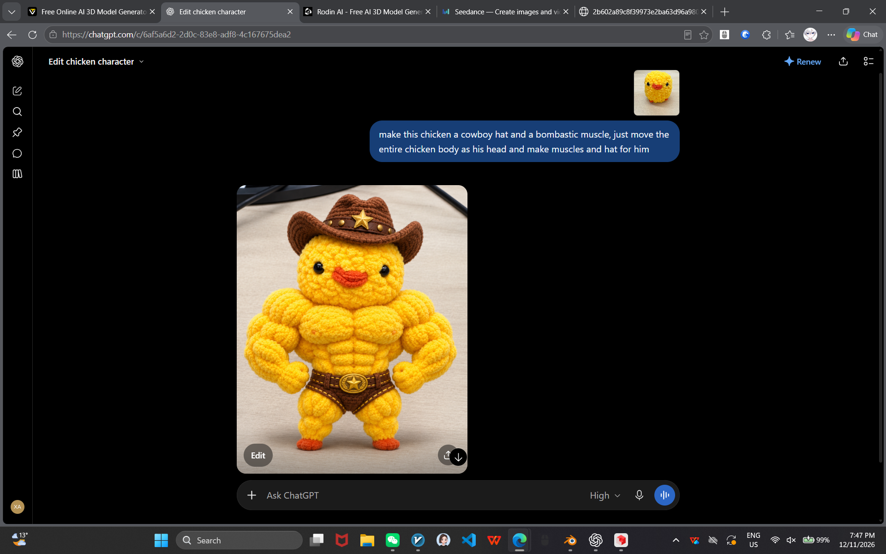
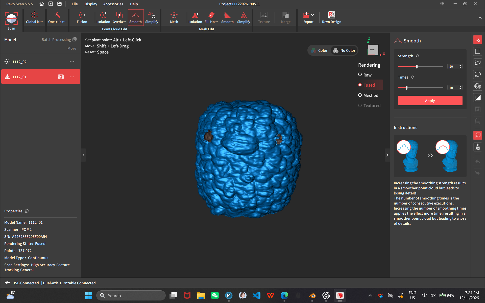
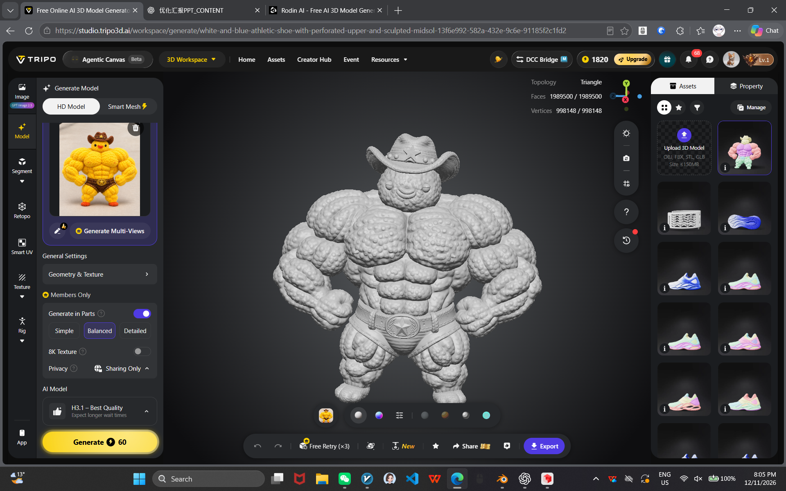
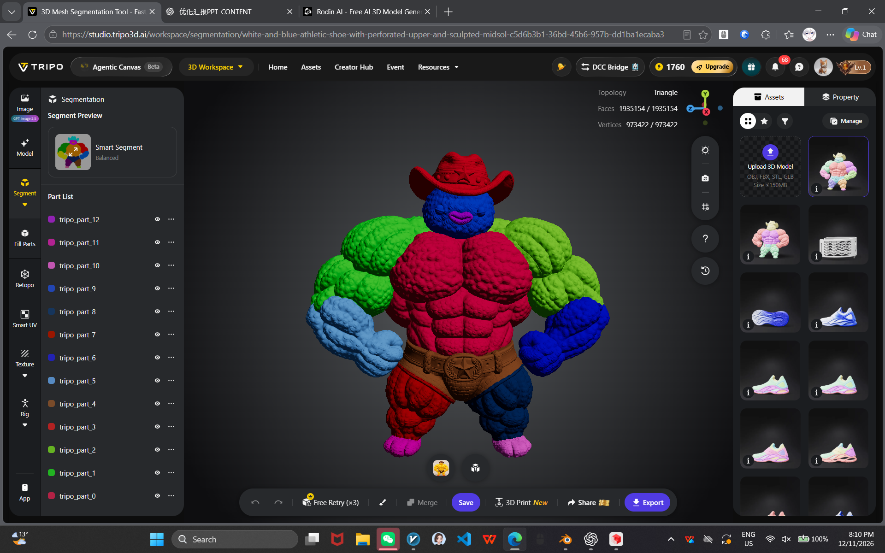
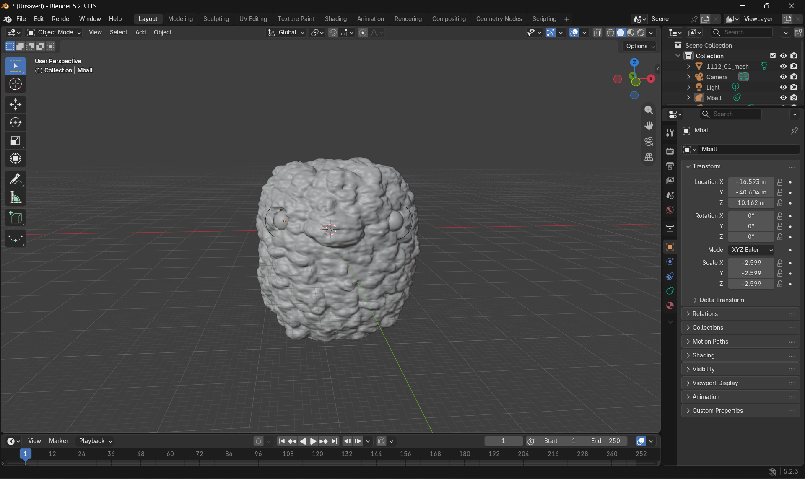
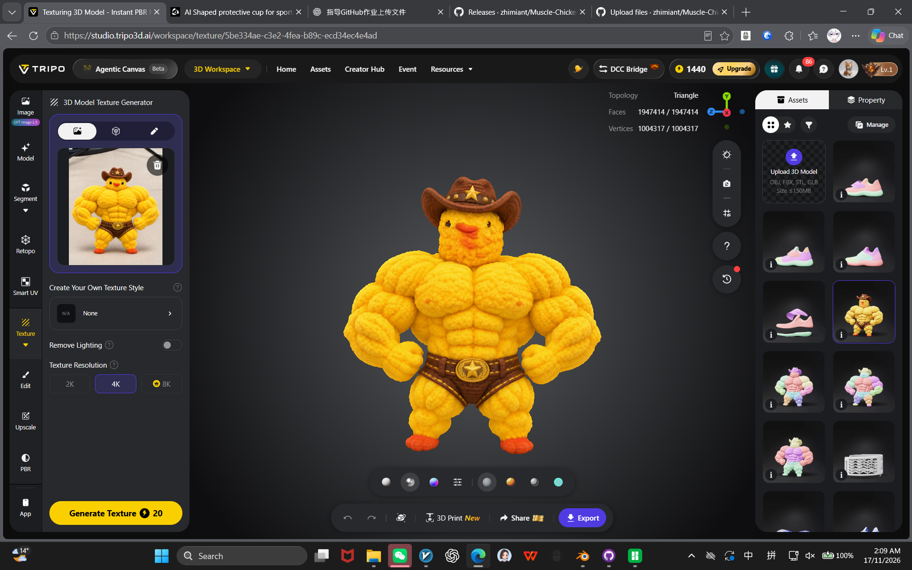

# MUSCLE CHICKEN
### 从实物扫描到AI辅助3D角色设计
**Class 01 · 3D Scanning & AI-Assisted 3D Modelling · Wanwu Lab · November 2026**

> **项目简介**｜从一只真实的黄色钩织小鸡出发，结合3D扫描、AI图像生成、Tripo三维建模与Blender编辑，将柔软、可爱的原型转化为具有牛仔帽和夸张肌肉造型的数字角色。此仓库保存了主要制作过程、阶段截图和可下载的模型文件。

---

## 1. What Is It? | 这是什么作品？

**Muscle Chicken（肌肉鸡）** 是一个将实物数字化与AI辅助造型相结合的角色设计实验。

项目最初的对象是一只黄色钩织小鸡。它原本的形态圆润、柔软，表面具有明显的编织纹理。我们先对实物进行3D扫描，获取它的数字几何形态；之后以小鸡的外观作为创作起点，通过AI图像生成提出新的角色设计：保留小鸡圆润的头部与辨识度高的脸部特征，加入牛仔帽、发达的肩臂肌肉和健壮的身体，形成可爱与力量感之间的视觉反差。

最终作品不是单纯的一张AI图片，而是一个经过三维生成与Blender调整的数字模型。项目同时保留了原始扫描数据、AI模型与可编辑的制作工程，展示了从**现实物体 → 数字扫描 → AI造型 → 三维编辑**的完整路径。

## 2. What Does It Do? | 它可以用来做什么？

**Muscle Chicken是一件静态数字角色作品**，而不是具有机械运动或交互功能的产品。

它主要用于展示三种设计可能性：

- **角色再设计：** 在保留原始小鸡形象特征的同时，借助夸张的身体比例建立鲜明的角色性格。
- **数字化展示：** 模型可以在Blender中旋转、缩放和调整视角，用于观察角色的整体轮廓、肌肉体块及配件关系。
- **数字制造探索：** 三维模型可以继续进行网格修复、尺度校正、切片与打印测试，作为后续实体制作的基础。

本次仓库中已经提供名为 `final_print_ready.zip` 的最终导出版本；**这不等于已经完成实体3D打印，也不代表打印适配性已经通过验证**。实际打印前仍需检查模型尺寸、闭合性、薄弱连接和支撑需求。

## 3. How Was It Made? | 它是如何制作的？

### 3.1 工具与文件

| 阶段 | 使用工具 | 主要任务 |
| --- | --- | --- |
| 实物扫描 | Revopoint POP 2、Revo Scan | 采集小鸡的三维形态并导出扫描数据 |
| 角色概念设计 | ChatGPT图像生成 | 设计牛仔帽、肌肉身体与角色比例 |
| AI三维建模 | Tripo | 将角色参考图转换为3D模型，查看整体与部件 |
| 网格编辑与组合 | Blender | 导入、缩放、调整及整理数字模型 |
| 成果整理 | GitHub | 保存模型文件、阶段图片与制作文档 |

### 3.2 Step 01 — 扫描真实的小鸡

使用 **Revopoint POP 2** 扫描黄色钩织小鸡，并在 **Revo Scan** 中查看扫描结果。扫描过程的重点是尽可能保留小鸡整体外形及表面的钩织质感，同时检查是否存在缺失、噪声和不完整区域。

钩织材质表面凹凸较多，扫描获得的网格不一定像规则工业零件那样平整，因此后续需要结合建模软件检查与处理。原始扫描文件予以保留，避免后期编辑覆盖最初的数据。

**原始扫描数据：** [original_scan.zip](models/original_scan.zip)

### 3.3 Step 02 — AI辅助角色概念设计

以小鸡照片为参考，在ChatGPT中探索形象变化：**让小鸡原本圆润的身体形象成为角色头部，并为它增加牛仔帽、强壮的手臂、胸腹部肌肉和腿部造型**。

生成过程并非一次完成，而是通过调整头身比例、肌肉体块和帽子的视觉效果，逐步明确角色方向。这个阶段的核心任务是建立清晰的3D建模参考，而不只是生成一张好看的效果图。

### 3.4 Step 03 — 通过Tripo生成三维模型

将确定的角色参考图用于 **Tripo** 的AI三维建模流程，生成可在三维空间观察的角色几何模型，并查看模型整体与部件结构。

AI生成模型提供了牛仔帽、肩臂、胸腹与腿部等复杂形态的基础，但其比例、连接关系与局部网格仍需要进一步检查，不能直接将图像生成结果等同于完成的可打印模型。

**AI生成模型文件：** [ai_generated_model.zip](models/ai_generated_model.zip)

### 3.5 Step 04 — 在Blender中编辑与整理

将扫描模型与AI生成的三维素材导入 **Blender**，围绕角色整体比例、位置和局部衔接进行检查和调整。工作重点包括：

1. 对比扫描获得的小鸡特征与AI角色的设计目标。
2. 检查AI生成模型的头身比例、肌肉体块以及帽子与头部的关系。
3. 使用移动、旋转和缩放等操作调整模型的空间位置与相对比例。
4. 查看模型表面、局部穿插和部件连接，保留后续修改所需的可编辑工程。

**可编辑工程文件：** [editable_project.zip](models/editable_project.zip)

### 3.6 Step 05 — 展示结果与3D打印准备

完成主要造型调整后，在三维软件中检查整体形态并保存用于展示的结果。随后整理最终导出文件，为切片与3D打印测试做准备。

**最终模型：** [final_print_ready.zip](models/final_print_ready.zip)

> **打印状态说明：** 目前仓库展示的是数字模型与打印准备文件，未在此记录已经验证的切片参数或实物打印结果。后续打印应先校验模型是否封闭、尺寸是否正确、悬空部位是否需要支撑，以及各连接处是否足够牢固。

### 3.7 复现流程 | Reproduction

如果希望从头复现类似的作品，可以按照以下顺序操作：

1. 准备一只具有清晰外形特征的实物小鸡，并使用3D扫描仪和配套软件采集模型。
2. 保存原始扫描数据，不要直接覆盖；在三维编辑软件中检查表面与缺失区域。
3. 使用小鸡照片生成带牛仔帽和肌肉身体的角色参考图，并反复调整造型比例。
4. 将参考图导入Tripo进行图像到3D的生成，下载模型并检查细节和部件结构。
5. 在Blender中导入素材，调整尺度、方向、位置和模型关系，保存可编辑工程。
6. 导出用于后续打印测试的模型文件，并在实际切片前重新检查几何问题。

### 3.8 遇到的问题与改进 | Problems & Iterations

**问题一：扫描表面复杂。** 钩织小鸡的表面纹理细碎、形状不规则，扫描结果容易出现起伏较多的网格。相比追求过度光滑，更重要的是先保留整体轮廓，再有针对性地检查缺失区域。

**问题二：AI图像与三维结构之间存在差异。** 二维参考图可以快速确定牛仔帽和肌肉造型，但转换为三维后，局部结构和比例未必符合预期，因此必须返回三维软件逐项检查。

**问题三：角色比例需要反复调整。** 小鸡头部与肌肉身体的大小关系直接决定最终形象是否协调。通过多轮修改概念图并在Blender中观察不同视角，逐步明确了作品的主要视觉特征。

**后续改进：** 如果继续制作实体版本，将重点检查网格封闭性、部件连接、细小突起的强度与打印支撑，并补充切片截图、参数和实际打印照片。

### 项目文件 | Project Files

| 文件 | 内容 |
| --- | --- |
| [original_scan.zip](models/original_scan.zip) | 原始3D扫描数据 |
| [ai_generated_model.zip](models/ai_generated_model.zip) | AI生成的3D模型 |
| [editable_project.zip](models/editable_project.zip) | 可编辑工程文件 |
| [final_print_ready.zip](models/final_print_ready.zip) | 用于后续打印准备的最终导出模型 |
| [images/](images/) | 扫描、AI生成、建模及Blender过程截图 |

---

*Class 01 · Digital Fabrication Documentation · Wanwu Lab*
